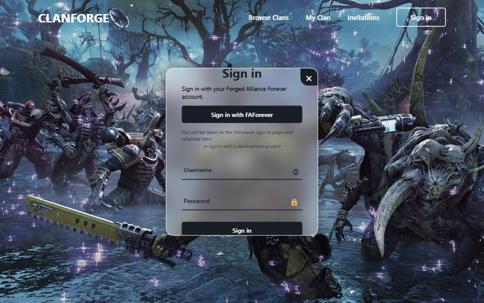
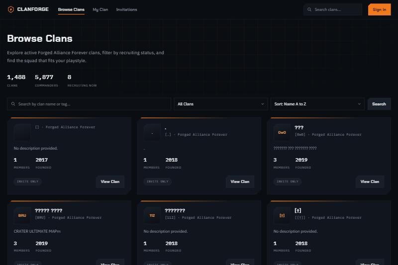
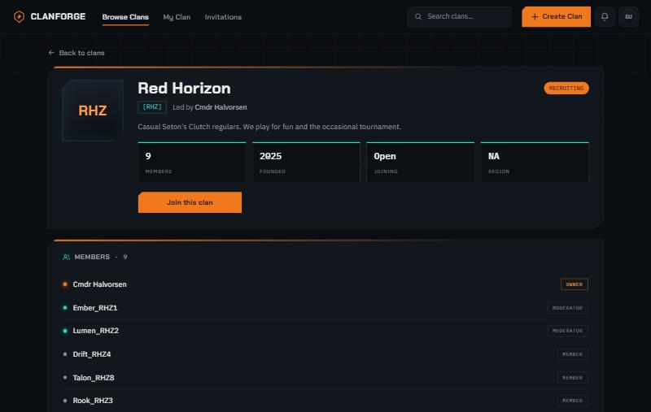
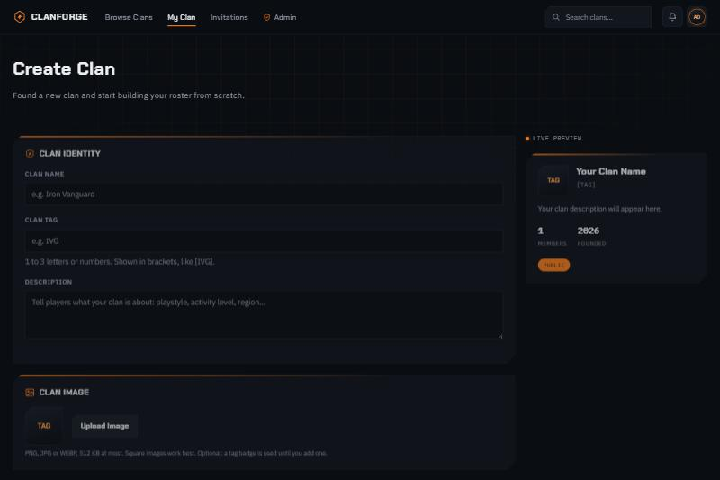
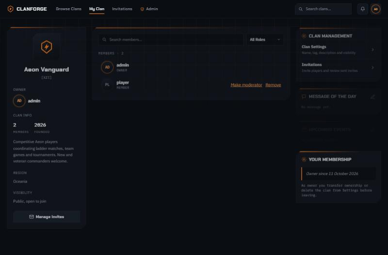
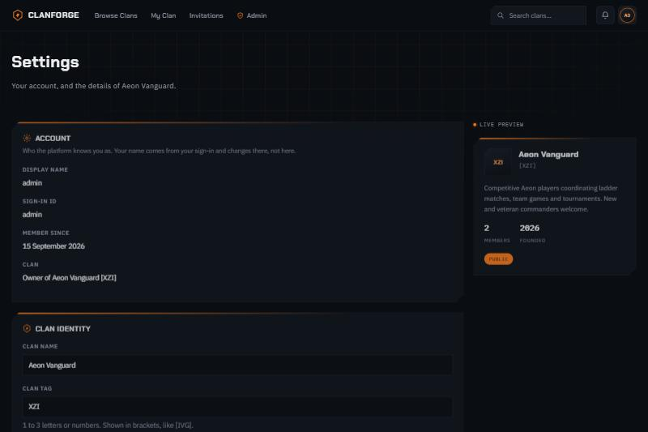
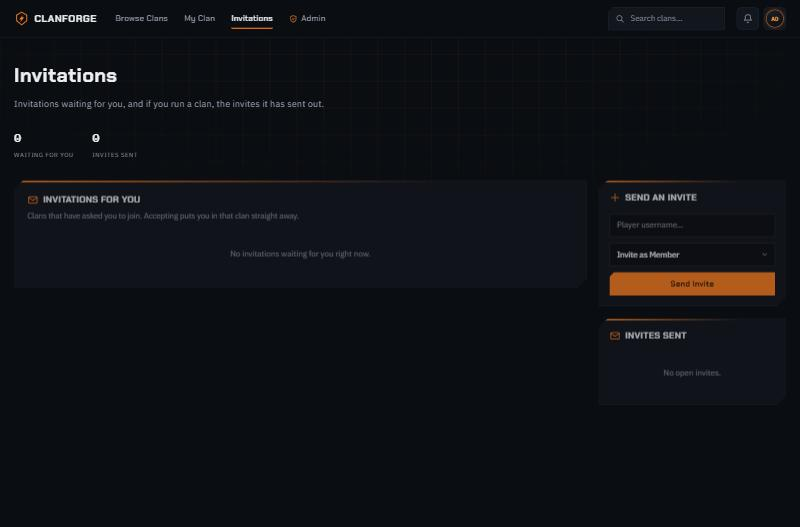
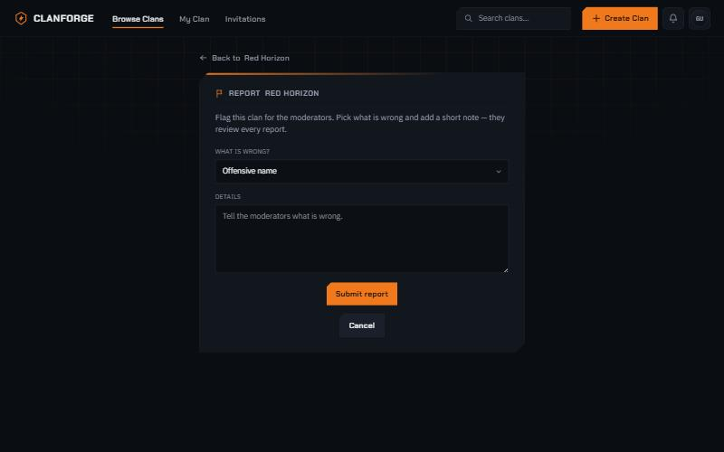
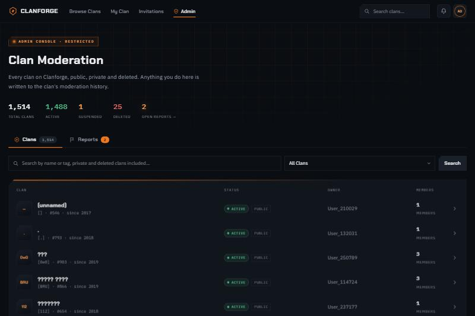
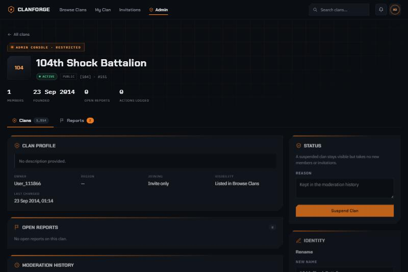

# Clanforge — User Guide

Clanforge is the Clan Management Platform for the Forged Alliance Forever community. It lets
players discover clans, create and run their own clan, manage members and invitations, and lets
administrators keep the community healthy. This guide walks through everything you can do in the
web interface.

> This is the **user guide**. For installing, building, deploying or testing the platform, see the
> [README](../README.md). For the REST API, see the live Swagger UI at `/swagger-ui.html`.

## Contents
1. [Signing in](#1-signing-in)
2. [Browsing and searching clans](#2-browsing-and-searching-clans)
3. [Viewing a clan and joining](#3-viewing-a-clan-and-joining)
4. [Creating your own clan](#4-creating-your-own-clan)
5. [Running your clan — the dashboard](#5-running-your-clan--the-dashboard)
6. [Clan settings](#6-clan-settings)
7. [Invitations](#7-invitations)
8. [Reporting a clan](#8-reporting-a-clan)
9. [For administrators](#9-for-administrators)
10. [Signing out](#10-signing-out)

---

## 1. Signing in

Clanforge uses your existing **Forged Alliance Forever** account — there is no separate Clanforge
password to create or remember. From any page, choose **Sign In**, then **Sign in with FAForever**.
You'll be taken to the FAForever sign-in page and returned to Clanforge once you're authenticated.

Browsing clans is open to everyone; signing in is what lets you **join**, **create** and **manage**
a clan, respond to **invitations**, and **report** a clan.

---

## 2. Browsing and searching clans

**Browse Clans** is the home of the platform. It lists every active clan and shows how many clans,
commanders and recruiting clans there are right now.

- **Search** by clan name or tag — matching is case-insensitive.
- **Filter** by recruiting status — All Clans, Recruiting, or Not Recruiting.
- **Sort** the results (for example, name A–Z, or by number of members).
- Each clan card shows its **tag**, **name**, **description**, **member count** and founding year,
  with a **View Clan** button to open its page.

---

## 3. Viewing a clan and joining

Opening a clan shows its details — tag, name, description, owner, when it was created, its
membership type (open or invite-only) and its current members.

A clan has two separate settings: whether it is **listed** (Public shows in Browse; Private is hidden)
and how you **join** it (open to join, or invite only). So a clan can even be *Public but invite-only* —
listed in Browse, yet joinable only by invitation.

**How you join:**

| Clan | How to join |
|---|---|
| **Public, open to join** | Join directly from the clan's page — no invitation needed. |
| **Invite only** (public or private) | You can only join if an owner or moderator **invites** you. |
| **Private** | Invitation only, and not shown in Browse at all. |

> **One clan at a time.** You can be an active member of **only one clan**. To join a different
> clan, leave your current one first.

---

## 4. Creating your own clan

If you're not already in a clan, choose **Create Clan** and fill in the form. A live preview on the
right shows how your clan card will look as you type.

- **Clan name** — your clan's full name.
- **Clan tag** — 1 to 3 letters or numbers, shown in brackets like `[IVG]`. Tags are unique
  (case-insensitive), so no two clans can share one.
- **Description** — tell players what your clan is about: playstyle and activity level.
- **Region** — your clan's main region (optional).
- **Visibility** — **Public** (listed in Browse) or **Private** (hidden from Browse).
- **Invitation only** — if on, players can join only by invitation (even a Public clan).
- **Clan image** — optional; a tag badge is used until you add one.

When you create a clan you become its **owner** and its first member.

---

## 5. Running your clan — the dashboard

**My Clan** is your clan's dashboard. The left panel shows the clan's identity, info, region and
visibility; the centre lists every member with their role; the right panel gives you quick access to
management, the message of the day, upcoming events and your own membership.

**Managing members:**
- **Search and filter** the roster by name or role (owners and moderators).
- **Remove** a member (owners and moderators; a moderator can't remove another moderator).
- **Make moderator / Make member** — promote or demote a member (**owner only**).
- **Transfer ownership** to another member (from Settings; **owner only**) — the previous owner stays
  on as a moderator.

**Roles:** every member is an **Owner**, **Moderator** or **Member**. Owners and moderators can
manage the clan; owners additionally can transfer ownership and delete the clan.

---

## 6. Clan settings

**Settings** is where owners and moderators change the clan's details. Your own display name comes
from your FAForever sign-in and can't be changed here.

From here you can update:
- **Clan identity** — name, tag and description (a live preview shows the result).
- **Preferences** — region, visibility (**Public**/**Private**), and whether the clan is **invitation only**.
- **Clan image** — upload a PNG, JPG or WEBP (512 KB max; square images work best).
- **Message of the day** — a note shown on the dashboard to every member.
- **Clan events** — add upcoming events (title, date and time in **UTC**) or remove them; they appear on the dashboard.

Click **Save Changes** to apply. The same validation that applies when creating a clan applies here
(for example, the tag rules and name/tag uniqueness).

---

## 7. Invitations

The **Invitations** page has two sides: invites you've received, and — if you run a clan — the
invites your clan has sent.

**If you own or moderate a clan**, use **Send an Invite**: enter a player's username, choose the
role to offer, and send. Pending invites appear under **Invites sent**, where you can **revoke** one
before it's answered.

**If you've been invited**, the invitation appears under **Invitations for you**. You can:
- **Accept** — this puts you straight into that clan (remember: one active clan at a time).
- **Decline** — the invitation is closed.

Invitations have a status — **Pending**, **Accepted**, **Declined**, **Revoked** or **Expired** —
and an expiry date, after which they can no longer be accepted.

---

## 8. Reporting a clan

If a clan has an **offensive name or tag**, or **inappropriate content**, you can report it (you'll
need to be signed in). On the clan's page, click **Report this clan** — this opens a short report
page where you choose the category and add a reason.

Your report goes to the administrators' moderation queue for review — see the next section.

---

## 9. For administrators

Administrators get a restricted **Admin console** for keeping the community healthy. It's locked to
the admin role — ordinary users can't reach it.

### The admin console

**Clan Moderation** lists **every** clan on the platform — public, private and even deleted — with
live totals for active, suspended and deleted clans and the number of open reports. A **Reports** tab
shows the queue of user-submitted reports.

Search for any clan (the search covers private and deleted clans too), then open its **dossier** to
act.

### Moderating a clan

A clan's dossier shows its profile, any open reports and its full moderation history, with the
moderation actions on the right.

Administrators can:
- **Suspend** a clan (with a reason) — a suspended clan keeps its members but takes no new members or
  invitations, drops out of Browse, and its public page is hidden, until an admin **lifts** the suspension.
- **Rename** a clan or **change its tag** — for example, to fix an offensive or invalid one. The same
  name and tag rules an owner must meet apply.
- **Delete** a clan — a *soft* delete: the clan is removed from use, but its record and moderation
  history are kept for the audit trail.
- **Review reports** and the clan's **moderation history**.

Every administrator action is written to an **append-only moderation history** that records who did
what and when — it can't be edited or erased.

---

## 10. Signing out

Use the account menu in the top-right corner to **sign out**. Your session ends immediately, and
pages that require a sign-in will ask you to log in again.

---

*Clanforge — FAForever Clan Management Platform. Screenshots are from the running application.*
